# actiongate

[](LICENSE)
[](go.mod)
[](https://github.com/muhammadusamahoyrr/actiongate/releases/latest)

**An action firewall for AI coding agents.**

Claude Code, Cursor and other agents can run shell commands, delete files and read your secrets. actiongate sits between the agent and your machine:

| Action | Result | Example |
|---|---|---|
| Harmless | ✅ passes instantly | `ls`, reading source files |
| Forbidden | 🛑 blocked, with the rule that fired | reading `.env`, `id_rsa` |
| Dangerous | ⏸️ waits until a human taps **Approve** in Slack | `rm -rf`, `git push --force`, `DROP TABLE` |

Every decision goes into a tamper-evident audit log that you can verify yourself.

> 📄 **Research paper:** *What Parsing Buys an Action Policy: Detection, Interruptions and Their Value for AI Coding Agents* ([PDF](docs/paper/main.pdf)). It measures what parsing shell commands buys a policy over matching their text, on a held-out benchmark and in a pre-specified test on 417 other developers' sessions. See [Research](#research).



---

## Quickstart

No Docker or database setup needed. `actiongate up` runs its own embedded PostgreSQL.

1. Download the binaries from the [latest release](https://github.com/muhammadusamahoyrr/actiongate/releases/latest), or build them with Go 1.25+: `go build -o bin/ ./cmd/...`

2. Start the stack and leave it running:
   ```bash
   actiongate up
   ```

3. In the project you want to protect (new terminal):
   ```bash
   actiongate protect claude-code
   ```

4. Start Claude Code there and ask it to read `.env` (blocked) or run `rm -rf` (waits for approval).

`actiongate up` is safe to re-run, for example after a reboot. While it is down, protected projects **fail closed**: governed tools are blocked, never silently allowed.

---

## Why actiongate

- **Works with closed agents.** No SDK and no code changes. It hooks in at the MCP tool boundary and through Claude Code's `PreToolUse` hook.
- **Your credentials stay home.** Decisions are made centrally, but tools run on your machine. An approved action runs only with a signed, single-use, 60-second grant that the gateway checks locally.
- **History can't be quietly rewritten.** Audit events are hash-chained and sealed into signed epochs. The `verify` tool recomputes every hash and signature from the raw rows, so an edit made directly in the database shows up as `ok:false` and names the exact event.

See it for yourself:
```bash
actiongate tamper-demo
```
This seals real events on a throwaway database, then acts as a malicious DBA: it disables the append-only trigger and rewrites an approval. The database accepts the edit, but verification fails and names the tampered event. Your real audit chain is never touched.

---

## How it works

```
 AI agent ──► gateway (your machine) ──► control plane (policy + approvals)
                  │                            │
                  │  signed, single-use grant  │──► Slack: [Approve] [Deny]
                  ▼                            ▼
             tool runs locally            hash-chained audit log
```

1. The **gateway** sends each tool call to the **control plane**.
2. The control plane checks it against ordered [CEL](https://cel.dev) rules (first match wins). It then issues a signed grant, denies the call and names the rule, or holds it for approval.
3. Approvals use single-use HMAC tokens resolved by compare-and-swap, so two approvers can't both resolve one request and replays are rejected.
4. The gateway checks the grant's signature, request hash and expiry before running the tool, then reports a signed outcome.
5. A background sealer chains and signs every event. If an outcome never arrives, the action is recorded as `OutcomeUnknown`, never guessed.

---

## Policy packs

Choose a pack when you protect a project, so you don't have to write rules yourself:

| Pack | Behavior |
|---|---|
| `claude-code` (default) | Blocks secret reads. Destructive and opaque shell/PowerShell commands wait for approval, however they are spelled. Everything else passes. |
| `paranoid` | Blocks secrets. **Every** shell command and file change waits for approval. Reads pass. |
| `relaxed` | Blocks secrets. Only catastrophic commands (`rm -rf /`, `dd`, `mkfs`, `DROP DATABASE`…) wait. |

```bash
actiongate protect claude-code -pack paranoid
```

Custom rules are plain JSON with CEL conditions. Rules can test the raw `params`, or the **facts** ActionGate derives by parsing the command: `facts.destructive`, `facts.secret_access` and `facts.opaque`. Every spelling of an operation (`rm -rf`, `rm -r -f`, `'r''m' -fr`, `bash -c '…'`, `find -delete`) yields the same fact, so a rule cannot be dodged by rephrasing:

```json
{ "id": "approve-destructive-in-prod",
  "condition": "facts.destructive && environment == \"prod\"",
  "decision": "requires_approval" }
```

Policies are compiled before they are saved, so a broken rule is rejected at setup time and never fails at runtime.

---

## Research

**Paper:** *What Parsing Buys an Action Policy: Detection, Interruptions and Their Value for AI Coding Agents*, Muhammad Usama, COMSATS University Islamabad, 2026 ([PDF](docs/paper/main.pdf)).

**Question.** Most agent guardrails decide by matching the command text. What does actually *parsing* the command buy? The paper holds the policy engine fixed and varies only what the rules see: the raw text (a substring pack and four regex policies), or three facts (`destructive`, `secret_access`, `opaque`) derived from a parsed shell syntax tree. Ablations replace the parser with a line tokenizer, an improved tokenizer, or the off-the-shelf tree-sitter-bash parser.

**Held-out benchmark** ([ActionGate-Bench](bench/): 150 actions written independently of the analyzer, evaluated once):

| Policy | Harmful stopped | Benign interrupted | Adaptive probes stopped | Own shell calls interrupted (20,284) |
|---|---|---|---|---|
| Substring rules (old v1 default) | 16.3% | 4.3% | 20.0% | 1.21% |
| Strong regex | 82.5% | 12.9% | 72.0% | 6.88% |
| Vocabulary-matched regex | 86.3% | 11.4% | 76.0% | 3.64% |
| Gate every command | 100% | 94.3% | 98.0% | 100% |
| Line tokenizer+ (no syntax tree) | 86.3% | 5.7% | 74.0% | 6.69% |
| **Parsed facts (current default)** | **90.0%** | **5.7%** | **78.0%** | **2.74%** |

**Pre-specified test on other developers.** The analyzer was frozen before these data were read. On 640,530 shell calls from 417 developers in the public [SWE-chat](https://huggingface.co/datasets/SALT-NLP/SWE-chat) corpus:

| Policy | Calls stopped (pooled) | Per developer (macro) | Developers where facts stop fewer / more |
|---|---|---|---|
| Line tokenizer+ | 3.82% | 3.75% | 251 / 28 |
| Vocabulary-matched regex | 3.16% | 2.33% | 166 / 86 |
| Tuned regex | 2.57% | 2.02% | 119 / 123 |
| **Parsed facts** | **1.98%** | **2.21%** | — |

**What we found.**
- Parsing buys **fewer interruptions** than a line tokenizer with the same rules: facts interrupt less for 251 developers and more for 28.
- Against a **tuned regex**, parsing buys *different*, not clearly fewer, interruptions. Most of the detection gain is vocabulary: a regex given the analyzer's word lists comes close.
- Limitations are stated in the paper. Some benchmarks and all audit labels were written by Claude agents (no human labels yet), and the audit of whether the extra stops are warranted was inconclusive. Ten deviations from the pre-specification are listed in [PREREGISTRATION.md](docs/research/PREREGISTRATION.md).

**Reproduce it.** Every number comes from the released harness (`cmd/agbench`), and [EVALUATION.md](docs/research/EVALUATION.md) gives the command behind each table. Policy evaluation takes well under a millisecond per action. Known gaps (inline interpreter code that builds strings at run time, unlisted credential stores such as `~/.kube/config`, tool-specific dry-run flags) are documented in the paper.

**Cite.**
```bibtex
@misc{usama2026parsing,
  author = {Muhammad Usama},
  title  = {What Parsing Buys an Action Policy: Detection, Interruptions and Their Value for {AI} Coding Agents},
  year   = {2026},
  note   = {Preprint},
  url    = {https://github.com/muhammadusamahoyrr/actiongate}
}
```

---

## More features

- **Slack approvals** with Approve/Deny buttons. Clicks are signature-verified and recorded with the approver's identity.
- **Any MCP agent:** wrap its server command as `gateway mcp -- <your server>`.
- **Any hook-based agent:** `gateway check` exits `0` allowed, `2` denied, `3` timeout.
- **Windows service:** `actiongate service install` keeps protection running across reboots.
- **Health report:** `actiongate doctor` checks the database, schema, tenant, keys, sealer and control plane.
- **Embedded PostgreSQL 18**, no Docker: downloaded once on the first `actiongate up`. Or point `-db-url` at your own PostgreSQL 18+.
- **Claude Code plugin** with `/actiongate:protect`, `/actiongate:status` and `/actiongate:tamper-demo`.

---

## Built with

Go · PostgreSQL (row-level security, append-only triggers) · pgx + sqlc · River · cel-go · mvdan/sh · ConnectRPC + Protobuf · Ed25519 · MCP Go SDK · Slack · Testcontainers

```bash
make test   # full suite against real PostgreSQL (Docker), with -race
make lint   # golangci-lint + buf lint + buf breaking-change check
```

Code layout: `cmd/` has five binaries (`actiongate`, `controlplane`, `gateway`, `ag-hook`, `verify`) plus the `agbench` evaluation tool. `internal/` holds the policy engine, the shell analyzer (`internal/facts`), approvals, grants, queue workers, sealer and MCP proxy. Database migrations are in `migrations/` and the wire contract is in `proto/`.

---

## Documentation

| Document | What it covers |
|---|---|
| [User Guide](docs/GUIDE.md) | Concepts, custom policies, Slack setup, audit verification, configuration, troubleshooting |
| [Manual setup](docs/MANUAL_SETUP.md) | Step-by-step setup with an external PostgreSQL |
| [Architecture](docs/plan.md) | Design record and decisions |
| [Tech stack](docs/tech-stack.md) | Technology choices and why |
| [Verification log](VERIFICATION.md) | What was tested, milestone by milestone |
| [Paper](docs/paper/main.pdf) | What Parsing Buys an Action Policy: detection, interruptions and their value for AI coding agents |
| [Reproducing the evaluation](docs/research/EVALUATION.md) | The command behind every number in the paper |
| [Claude plugin](claude-plugin/) | Slash commands for Claude Code |

## License

Apache-2.0. See [LICENSE](LICENSE).
